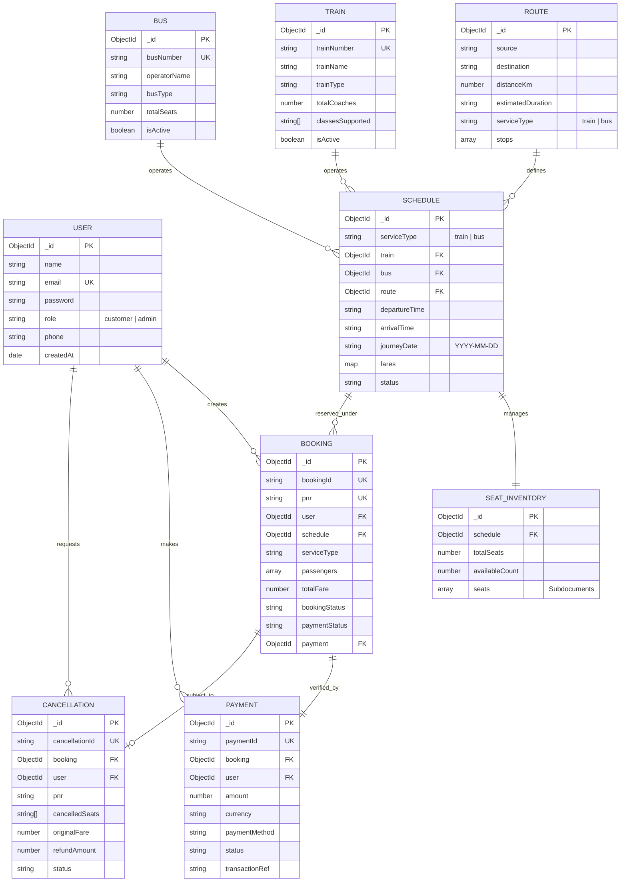

# Database Design & Data Architecture
## Online Railway & Bus Ticket Booking System

### 1. Entity-Relationship (ER) Diagram

---

### 2. Collection Schemas & Data Dictionary

#### 2.1 Users Collection
- **`_id`**: Unique ObjectId.
- **`email`**: String, unique, lowercase, indexed. Primary authentication identifier.
- **`password`**: String, bcrypt hashed (cost factor 10), hidden by default (`select: false`).
- **`role`**: Enum (`customer`, `admin`), default `customer`.
- **`phone`**: String, optional customer contact number.

#### 2.2 Trains & Buses Collections
- **`trainNumber` / `busNumber`**: Unique alphanumeric identification strings (e.g. `12952`, `KA-01-F-7788`).
- **`classesSupported`**: Array of coach classes (`1AC`, `2AC`, `3AC`, `CC`, `SL`).
- **`totalSeats` / `totalCoaches`**: Capacity planning attributes.

#### 2.3 Routes Collection
- **`source` / `destination`**: Clean normalized city/station names.
- **`stops`**: Array of intermediate halt stations with distance and halt timings.
- **Compound Index**: `{ source: 1, destination: 1, serviceType: 1 }` for sub-millisecond search queries.

#### 2.4 Schedules Collection
- **`journeyDate`**: Format `YYYY-MM-DD` indexed with `serviceType` for fast calendar lookups.
- **`fares`**: Dynamic pricing map for each seat tier (e.g. `1AC: 45.00, 2AC: 32.00, SL: 15.00`).

#### 2.5 Seat Inventory Collection
- **`schedule`**: 1-to-1 reference to the schedule.
- **`seats`**: Subdocuments containing:
  - `seatNumber`: e.g. `A1`, `B2`, `S14`, `U3`
  - `seatClass`: e.g. `1AC`, `2AC`, `Sleeper`, `Seater`
  - `berthType`: `Window`, `Aisle`, `Lower Berth`, `Upper Berth`, etc.
  - `status`: `available`, `reserved`, `booked`
  - `reservedBy`: User ObjectId
  - `reservedAt`: Timestamp for auto-release expiration

#### 2.6 Bookings, Payments & Cancellations
- **`pnr`**: 10-character unique verification code generated on payment confirmation.
- **`passengers`**: Detailed passenger manifest containing name, age, gender, assigned seat, and fare.
- **`payment`**: Reference to simulated transaction with sandbox transaction reference.
- **`cancellation`**: Full audit trail recording refunded amounts and restored seat inventory.
